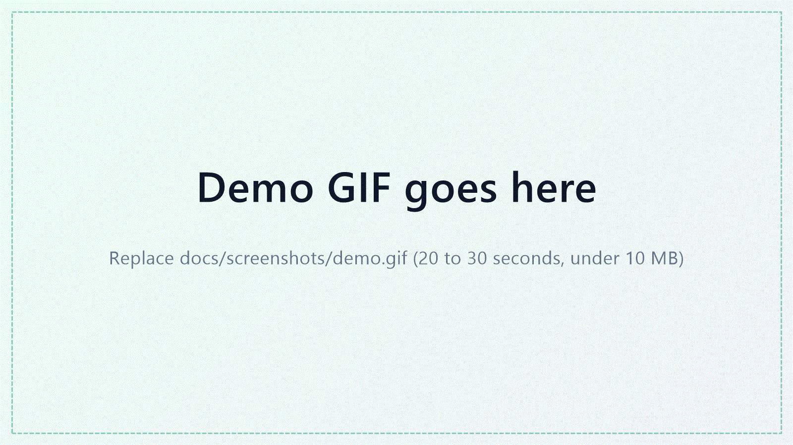
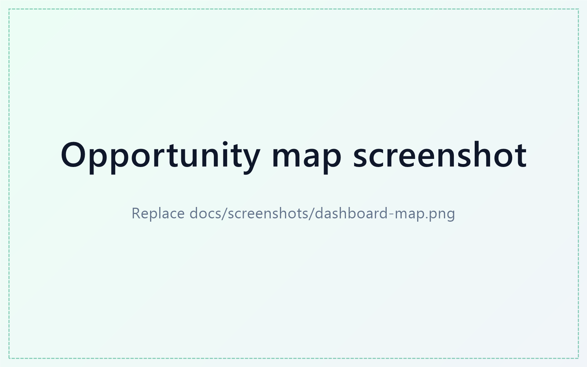
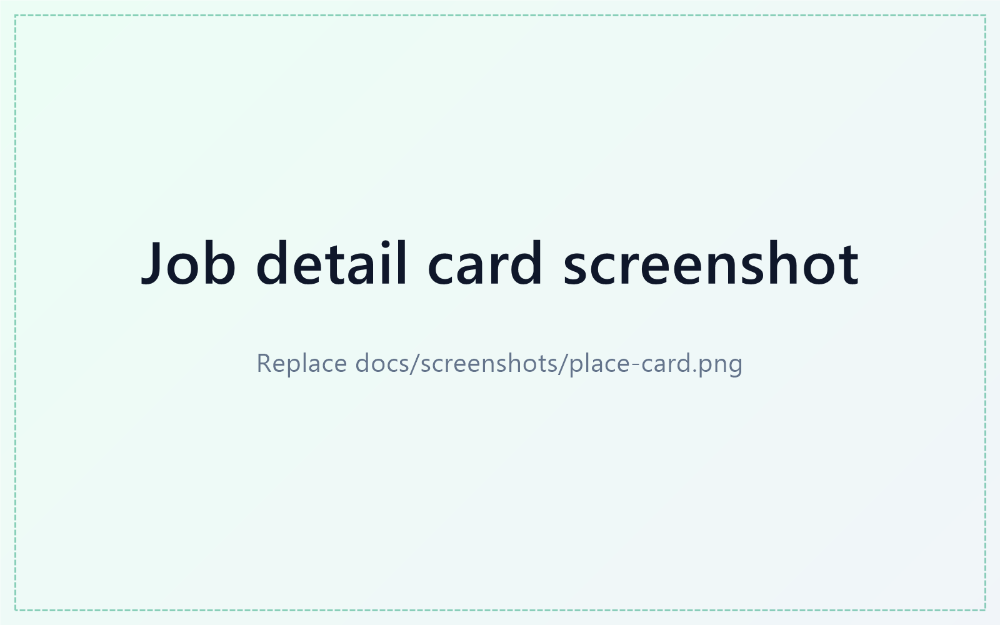
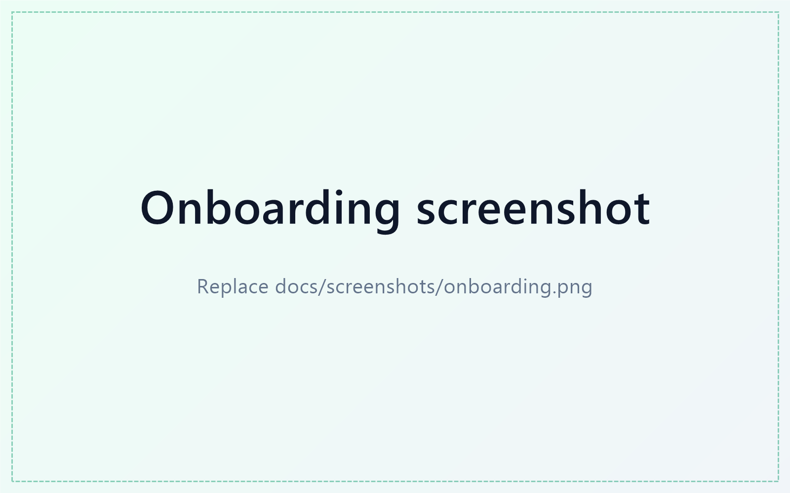
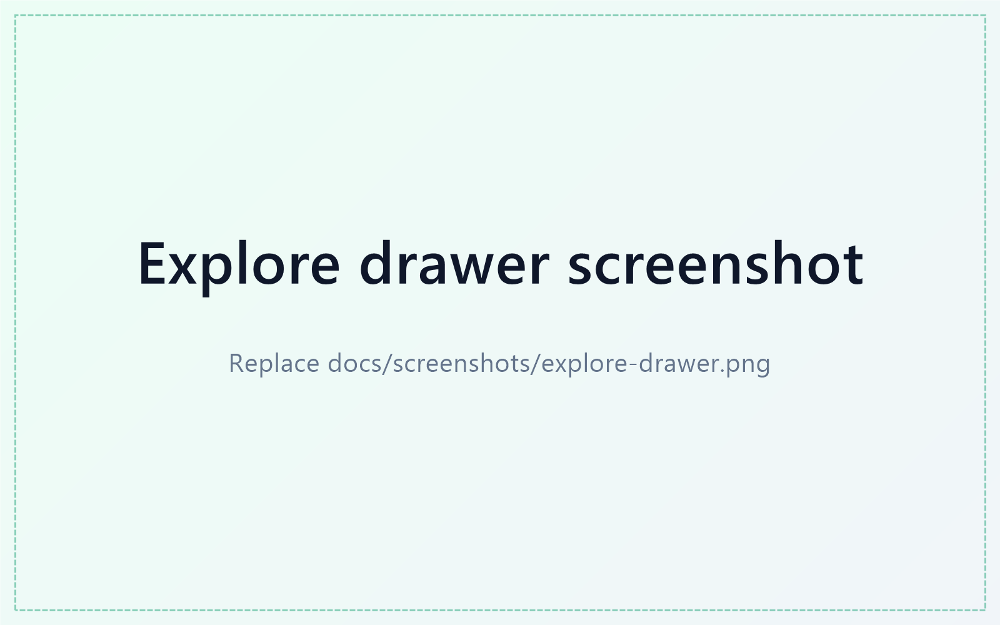

<h1 align="center">
  <!-- Assets: frontend/public/logo.svg (full) and logo-mark.svg (icon only) -->
  
</h1>

[](https://github.com/mr-anjaneyam/JobTrace/actions/workflows/ci.yml)
[](LICENSE)
[](https://www.python.org/)

**Self-hosted job tracker that watches company career portals, scores openings against your resume, and alerts you on Telegram.**

JobTrace polls applicant tracking systems directly, diffs postings against a local SQLite database, scores each new opening with an LLM (or a free offline matcher), and sends you a short Telegram message when something relevant appears. A React dashboard lets you browse and search everything it found.

<!-- DEMO: overwrite docs/screenshots/demo.gif (20 to 30 seconds, under 10 MB). Show onboarding, the map filling in, a place card, and a Telegram alert. -->
<p align="center">
  
</p>

## Screenshots

<!-- Overwrite the files in docs/screenshots/ keeping the same names; no README edits needed. -->
<table>
  <tr>
    <td width="50%"><br><sub><b>Opportunity map</b>: every role placed by fit</sub></td>
    <td width="50%"><br><sub><b>Job detail</b>: score breakdown and live status</sub></td>
  </tr>
  <tr>
    <td width="50%"><br><sub><b>Onboarding</b>: set up in about two minutes</sub></td>
    <td width="50%"><br><sub><b>Explore</b>: search, sort and compare</sub></td>
  </tr>
  <tr>
    <td colspan="2" align="center"><br><sub><b>Telegram alerts</b> for strong new matches</sub></td>
  </tr>
</table>

## Features

- **Direct ATS integration:** Greenhouse, Lever, Ashby, Workable, Workday, Oracle Recruiting Cloud and Atlassian, plus the Remotive and Arbeitnow feeds.
- **Telegram alerts and weekly digests:** no SMTP setup, messages are HTML-escaped and split to fit Telegram's 4096 character limit.
- **Stateful tracking:** every fetched job is stored, so a posting that fails your filters is never reported as "closed" by mistake. Roles that disappear from a board are marked closed.
- **Stable job IDs:** tracking parameters (`utm_*`, `gh_src`, `lever-source`, ...) are stripped before hashing.
- **Seniority, location and relevance gates:** intern, junior, mid, senior, lead or any. Mismatched roles are capped in code, without spending tokens.
- **Token budget controls:** batch scoring (up to 25 jobs per request), an optional free local triage, and a daily token limit.
- **Pluggable scoring:** xkiro, OpenAI, OpenRouter, Ollama, Cursor, JEV, a built-in offline matcher, or none.
- **Web dashboard:** opportunity map, match matrix, job detail, compare view, FTS5 full-text search, live scan progress over Server-Sent Events, resume upload and settings.
- **Cross-platform:** Windows (PowerShell), macOS and Linux.

See [OVERVIEW.md](OVERVIEW.md) for the architecture, database schema and design notes.

## Quick start

### Option A: Docker (recommended)

Requires Docker with Compose v2.

```bash
git clone https://github.com/mr-anjaneyam/JobTrace.git
cd JobTrace
docker compose up -d
```

Open <http://localhost:8000>. A short onboarding asks for your name and resume, what you are looking for, and optionally your Telegram bot and an LLM key, then scans in the background. Come back in a few minutes.

What runs: a `web` container (UI and API) and a `scheduler` container (daily alerts at 09:30, weekly digest on Mondays at 09:00). They share one named volume, `jobtrace-data`, which holds the database, `config.yaml`, `.env` and your resume.

| Task | Command |
|---|---|
| Logs | `docker compose logs -f` |
| Stop | `docker compose down` (data is kept) |
| Update | `git pull && docker compose up -d --build` |
| Different port | `JOBTRACE_PORT=9000 docker compose up -d` |
| Local timezone for the scheduler | `TZ=Asia/Kolkata docker compose up -d` |
| Back up data | `docker run --rm -v jobtrace_jobtrace-data:/data -v "$PWD":/backup alpine tar czf /backup/jobtrace-data.tgz -C /data .` |
| Erase everything | `docker compose down -v` |

The port is published on `127.0.0.1` only because the API has no authentication.

**Ollama:** containers reach Ollama on the host through `host.docker.internal` (set automatically via `OLLAMA_BASE_URL`, and `extra_hosts` handles Linux). On Linux, start Ollama with `OLLAMA_HOST=0.0.0.0` so it listens beyond loopback. For Ollama on another machine, run `OLLAMA_BASE_URL=http://that-host:11434 docker compose up -d`.

### Option B: Run from source

Requirements: Python 3.10+ and Node.js 18+.

```bash
git clone https://github.com/mr-anjaneyam/JobTrace.git
cd JobTrace

# Backend
pip install -r requirements.txt

# Frontend
cd frontend && npm install && cd ..
```

`config.yaml` and `.env` are created for you on first run (both are git-ignored). `./install.sh` does the whole setup on macOS and Linux, inside a virtualenv.

Start the backend and the dashboard together:

```powershell
# Windows
.\start.ps1        # or start.bat
```
```bash
# macOS / Linux
./start.sh
```

Then open <http://localhost:3000> and follow the onboarding. The API listens on <http://127.0.0.1:8000> (interactive docs at `/docs`). `stop.ps1` / `stop.sh` shut everything down. To run onboarding again later, open `/welcome`.

## Configuration

Onboarding covers all of this; the details below are for editing it later (Settings in the dashboard, or the files directly).

1. **Telegram:** create a bot with [@BotFather](https://t.me/BotFather), message it once, then find your chat ID via [@userinfobot](https://t.me/userinfobot). Enter both in the dashboard under Settings, or set `TELEGRAM_BOT_TOKEN` and `TELEGRAM_CHAT_ID` in `.env`. Multiple chat IDs are supported.
2. **Resume:** upload a PDF, DOCX, TXT or MD file in the dashboard (Candidate Profile), or set `resume_path` in `config.yaml`.
3. **Scoring provider:** set `llm.provider` in `config.yaml` and the matching key in `.env` (see [.env.example](.env.example)). Use `local` for free offline matching or `none` to skip scoring.
4. **Companies and filters:** edit `companies`, `filters`, `candidate` and `alerts` in `config.yaml`. [config.example.yaml](config.example.yaml) documents every option.

Secrets live only in `.env` and `config.yaml`, both ignored by git. The settings API never returns full secrets, only a masked tail.

### Performance on low-end machines

The dashboard switches to a lite mode automatically on devices with 4 or fewer CPU cores, 4 GB or less memory, or reduced-motion enabled. Lite mode drops shadows, animations, the background grid and quadrant tints, and shows up to 80 map pins instead of 150. Force a mode from the browser console and reload:

```js
localStorage.setItem('jobtrace.perf', 'lite');   // or 'full'; removeItem to go back to auto
```

## Command line

Run from the `backend/` directory (Windows users can use `.\run.ps1 <command>` from the repo root):

```bash
python -m jobtrace.main scan             # fetch, diff and score
python -m jobtrace.main alert            # Telegram alert for watched companies
python -m jobtrace.main digest           # weekly digest
python -m jobtrace.main run              # scan + digest
python -m jobtrace.main recap            # re-apply seniority/relevance caps (0 tokens)
python -m jobtrace.main list --days 7    # recent openings in the terminal
python -m jobtrace.main prune            # delete long-closed listings and shrink the database
python -m jobtrace.main test             # verify Telegram credentials
python -m jobtrace.main web --port 8000  # API server only
python -m jobtrace.main daemon           # built-in scheduler
```

`alert` and `digest` accept `--dry-run` to preview without sending.

### Scheduling

`daemon` runs a daily alert pass at 09:30 and a weekly digest (scan first) on Mondays at 09:00, catching up if it starts late. You can also schedule `alert` and `run` with cron, Task Scheduler or systemd timers.

### Environment variables

| Variable | Default | Purpose |
|---|---|---|
| `JOBTRACE_HOME` | repo root | Folder holding `config.yaml`, `.env`, the database and your resume (`/data` in Docker) |
| `JOBTRACE_HOST` | `127.0.0.1` | Interface the API binds to (`0.0.0.0` inside the container) |
| `JOBTRACE_RELOAD` | unset | Set to `1` for auto-reload while developing the backend |
| `JOBTRACE_PORT` | `8000` | Published port in `docker-compose.yml` |
| `OLLAMA_BASE_URL` | `http://localhost:11434` | Where the `ollama` provider connects (`host.docker.internal` in Docker) |

### Large databases

Each scan deletes listings that closed more than `storage.retention_days` ago (default 90, `0` keeps everything), and `python -m jobtrace.main prune` does the same on demand and also compacts the file. The dashboard loads at most the 4000 best-scored open roles, compressed with gzip, from an indexed query, so it stays fast as the history grows. Search (FTS5) still covers everything in the database.

### Network exposure

The API binds to `127.0.0.1` by default and has no authentication. Set `JOBTRACE_HOST` only if you understand the risk, and never expose it to the internet without a reverse proxy that adds authentication. The dev server started by `start.ps1` / `start.sh` listens on all interfaces on purpose, so you can reach the dashboard through a tunnel; put authentication in front of it (for example Cloudflare Access) before exposing it beyond your own network.

## Development

```bash
pip install -r backend/requirements-dev.txt
cd backend && python -m pytest          # backend tests (use a temporary project root)
cd frontend && npx tsc --noEmit         # type-check
cd frontend && npm run build            # production build
```

```
JobTrace/
├── backend/
│   ├── jobtrace/        # Python package: pipeline, sources, store, scoring, Telegram, scheduler
│   │   └── web/         # FastAPI server
│   └── tests/           # pytest suite
├── frontend/            # React 19 + Vite + Tailwind dashboard and onboarding
├── docs/screenshots/    # README images (placeholders until you add real ones)
├── Dockerfile           # multi-stage image: builds the UI, serves it from the API
├── docker-compose.yml   # web + scheduler sharing one data volume
├── config.example.yaml  # configuration template
├── .env.example         # secrets template
├── start.* / stop.*     # full-stack launchers (PowerShell, bash, batch)
└── run.ps1              # Windows CLI wrapper
```

## Contributing

Bug reports, feature ideas and pull requests are welcome. Please read [CONTRIBUTING.md](CONTRIBUTING.md) and the [Code of Conduct](CODE_OF_CONDUCT.md) first. Report security issues privately as described in [SECURITY.md](SECURITY.md).

Good first contributions: a new ATS adapter in `backend/jobtrace/sources.py`, a new scoring provider in `backend/jobtrace/llm.py`, or more tests.

## License

MIT. See [LICENSE](LICENSE).
