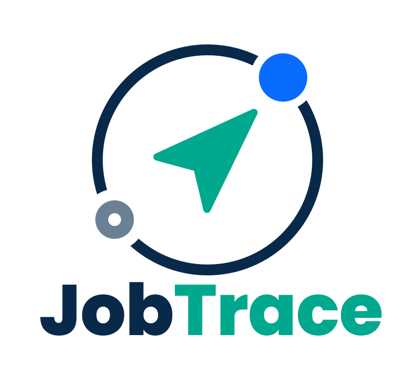
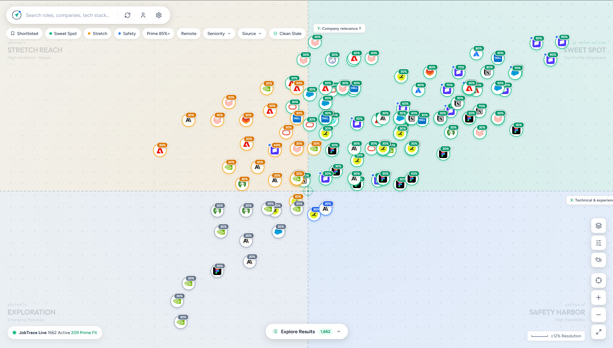
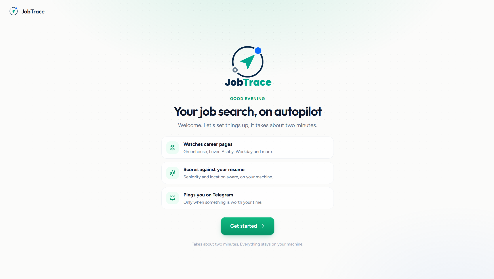
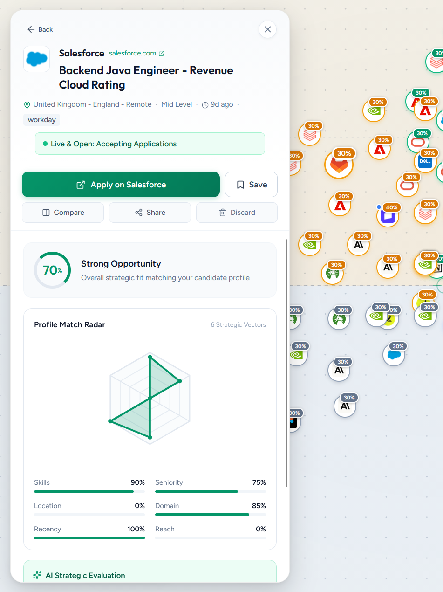
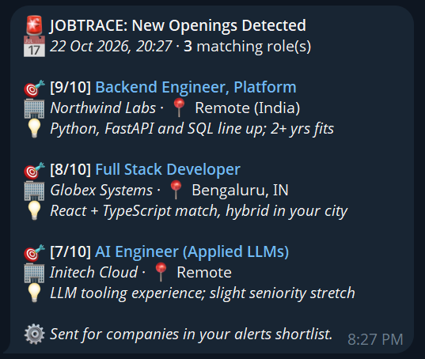
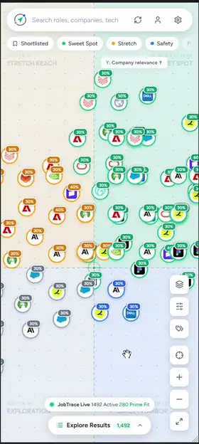
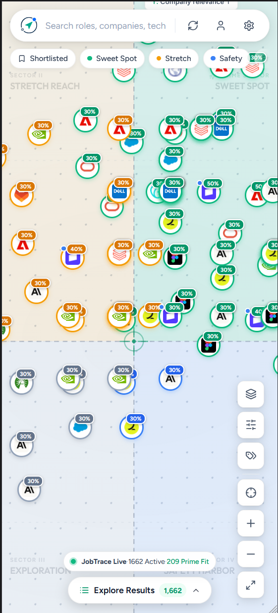
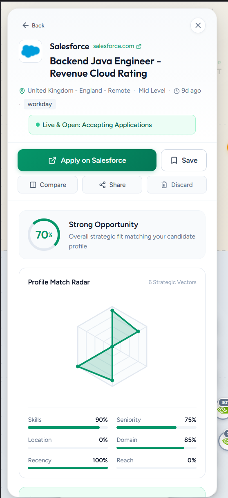
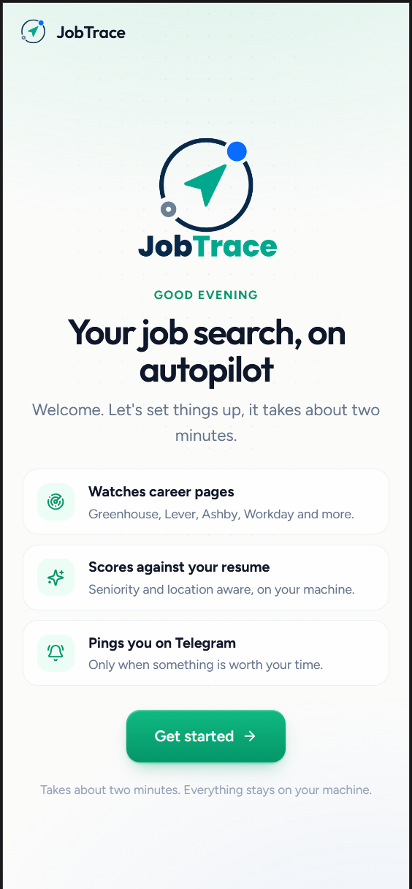
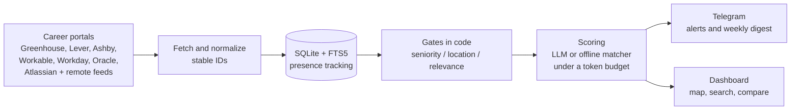

<div align="center">

<!-- Assets: frontend/public/logo.svg (full) and logo-mark.svg (icon only) -->


### Your job search, minus the 47 open tabs.

**A self-hosted tracker that watches company career pages, scores every opening against your resume, and pings you on Telegram only when something is worth your time.**

[](https://github.com/mr-anjaneyam/JobTrace/actions/workflows/ci.yml)
[](https://github.com/mr-anjaneyam/JobTrace/releases)
[](LICENSE)
[](https://www.python.org/)
[](#-quick-start)
[](https://github.com/mr-anjaneyam/JobTrace/stargazers)

<a href="https://42loop.com/posts/CpbRMv2NEwiaxE3nXnfb"></a>

[Quick start](#-quick-start) &nbsp;•&nbsp; [Features](#-what-it-does) &nbsp;•&nbsp; [How it works](#-how-it-works) &nbsp;•&nbsp; [Configure](#-configuration) &nbsp;•&nbsp; [FAQ](#-faq) &nbsp;•&nbsp; [Contribute](#-contributing)

</div>

<p align="center">
  <a href="docs/vid/desktop_demo.mp4"></a>
  <br>
  <sub>▶ <a href="docs/vid/desktop_demo.mp4">Watch it in full quality (28 s)</a></sub>
</p>

## 🤔 Why this exists

Job hunting has a boring core: open the same career pages, squint at the same titles, close the ones that want 8 years of experience for an "entry-level" role, repeat tomorrow. F5 is not a job-search strategy.

JobTrace is the friend who does the refreshing for you. It reads the postings straight from the source, remembers what it has already seen, judges each new role against your resume, and texts you only when something clears the bar. Your resume stays on your machine, and so does your data.

## 🖼️ Screenshots

<p align="center">
  
  <br>
  <sub><b>Opportunity map</b>: every role placed by fit, so the good ones float to the top-right</sub>
</p>

<table>
  <tr>
    <td width="62%" valign="top" align="center"><br><sub><b>Onboarding</b>: two minutes, no config files, no tears</sub></td>
    <td width="38%" valign="top" align="center"><br><sub><b>Job card</b>: score breakdown and a live check that the posting still exists</sub></td>
  </tr>
</table>

<p align="center">
  
  <br>
  <sub><b>Telegram alerts</b>: a buzz in your pocket, not another inbox</sub>
</p>

## 📱 On your phone

The dashboard and onboarding are responsive. Below 768 px the place card and explore drawer become full-width sheets, the map moves with drag and pinch, and onboarding collapses to a single column. Job hunting from the sofa is now a supported use case.

<table align="center">
  <tr>
    <td align="center"><a href="docs/vid/mobile_demo.mp4"></a><br><sub><b>In motion</b> (<a href="docs/vid/mobile_demo.mp4">full video</a>)</sub></td>
    <td align="center"><br><sub><b>Map</b></sub></td>
    <td align="center"><br><sub><b>Job card</b></sub></td>
    <td align="center"><br><sub><b>Onboarding</b></sub></td>
  </tr>
</table>

> [!TIP]
> To open it on your phone, reach your machine over a private tunnel or VPN such as Tailscale or Cloudflare Access. The API has no authentication of its own, so do not publish the port directly.

## ✨ What it does

| | Feature | The short version |
|---|---|---|
| 🔌 | **Direct ATS integration** | Greenhouse, Lever, Ashby, Workable, Workday, Oracle Recruiting Cloud and Atlassian, plus the Remotive and Arbeitnow feeds. No job-board middlemen. |
| 💬 | **Telegram alerts and digests** | No SMTP, no app passwords. Long digests are split to fit Telegram's message limit and all text is HTML-escaped. |
| 🧠 | **Stateful tracking** | Every fetched job is stored, even ones your filters reject, so changing a filter never fakes a "closed" role. Roles that vanish from a board are marked closed. |
| 🪪 | **Stable job IDs** | Tracking junk (`utm_*`, `gh_src`, `lever-source`...) is stripped before hashing. A job does not become "new" because marketing added a query string. |
| 🎚️ | **Seniority, location and relevance gates** | Intern to lead, or any. A "Director of Everything" is capped in plain code no matter how excited the model is, and it costs zero tokens. |
| 💸 | **Token budget controls** | Batched scoring (up to 25 jobs per request), an optional free local triage, and a daily token limit, so a scan never eats your API credits. |
| 🔁 | **Pluggable scoring** | xkiro, OpenAI, OpenRouter, Ollama, Cursor, JEV, a built-in offline matcher (no key, no cloud), or none at all. |
| 🗺️ | **A dashboard you will actually open** | Opportunity map, match matrix, compare view, FTS5 full-text search, live scan progress, resume upload and settings. |
| 🧭 | **Guided first run** | A step-by-step onboarding, then a progress bar while it does the first scan. It tells you to come back later, and means it. |
| 🖥️ | **Runs anywhere** | Docker Compose, or from source on Windows, macOS and Linux. |

## 🧩 How it works



Deeper dive: [OVERVIEW.md](OVERVIEW.md) covers the schema and design notes.

## 🚀 Quick start

### Option A: Docker (recommended)

> [!NOTE]
> Needs Docker with Compose v2. That is the whole prerequisites list.

```bash
curl -fsSLO https://github.com/mr-anjaneyam/JobTrace/releases/latest/download/docker-compose.yml
docker compose up -d
```

(On Windows PowerShell use `curl.exe`.) That pulls the prebuilt image from GitHub Container Registry. No clone, no build, no Node or Python on your machine. Images are published for `amd64` and `arm64`, so a Raspberry Pi or an Apple Silicon Mac is fine.

Prefer a single container? The UI and first scan work on their own; add the scheduler later for daily alerts:

```bash
docker run -d --name jobtrace -p 127.0.0.1:8000:8000 -v jobtrace-data:/data ghcr.io/mr-anjaneyam/jobtrace:latest
```

Open <http://localhost:8000>. The onboarding asks for your name and resume, what you are looking for, and optionally a Telegram bot and an LLM key. Then it scans in the background. Go make tea; come back in a few minutes.

Two containers run: `web` (UI and API) and `scheduler` (daily alerts at 09:30, weekly digest on Mondays at 09:00). They share one named volume, `jobtrace-data`, which holds the database, `config.yaml`, your resume and, once you save secrets, `.env`.

<details>
<summary><b>Everyday Docker commands</b></summary>

| Task | Command |
|---|---|
| Logs | `docker compose logs -f` |
| Stop (data is kept) | `docker compose down` |
| Update | Download the newest `docker-compose.yml` from the releases page, then `docker compose up -d` |
| Pin a version | `JOBTRACE_VERSION=1.2.0 docker compose up -d` |
| Which version am I on? | open `/api/version` |
| Different port | `JOBTRACE_PORT=9000 docker compose up -d` |
| Scheduler in your timezone | `TZ=Asia/Kolkata docker compose up -d` |
| Back up data | `docker run --rm -v jobtrace_jobtrace-data:/data -v "$PWD":/backup alpine tar czf /backup/jobtrace-data.tgz -C /data .` |
| Erase everything | `docker compose down -v` |

</details>

<details>
<summary><b>Image tags</b></summary>

Each release publishes `ghcr.io/mr-anjaneyam/jobtrace` with the tags `1.4.2`, `1.4`, `1` and `latest`. Pre-releases (such as `1.5.0-rc.1`) get only their own tag. Pin an exact version if you like your upgrades deliberate.

</details>

<details>
<summary><b>Building the image yourself (contributors)</b></summary>

```bash
git clone https://github.com/mr-anjaneyam/JobTrace.git
cd JobTrace
docker compose up -d --build
```

The compose file in the repo root builds from your checkout; the one attached to each release uses the published image.

</details>

<details>
<summary><b>Using Ollama with Docker</b></summary>

Containers reach Ollama on the host through `host.docker.internal`. That is set automatically through `OLLAMA_BASE_URL`, and `extra_hosts` covers Linux. On Linux, start Ollama with `OLLAMA_HOST=0.0.0.0` so it listens beyond loopback. For Ollama on another machine:

```bash
OLLAMA_BASE_URL=http://that-host:11434 docker compose up -d
```

</details>

> [!WARNING]
> The web port is published on `127.0.0.1` only, on purpose: the API has no authentication. Please do not "fix" that without something like a reverse proxy with auth in front.

### Option B: Run from source

Requirements: Python 3.10+ and Node.js 18+.

```bash
git clone https://github.com/mr-anjaneyam/JobTrace.git
cd JobTrace

# Windows
.\start.ps1        # or start.bat

# macOS / Linux
./start.sh
```

The start scripts check your Python version, install any missing backend and frontend dependencies, and launch both servers. Then open <http://localhost:3000> and follow the onboarding. The API listens on <http://127.0.0.1:8000> (interactive docs at `/docs`). Stop everything with `stop.ps1` or `stop.sh`.

`config.yaml` is created for you on first run, and `.env` appears when you save your first secret. Prefer a virtualenv? `./install.sh` sets one up (macOS and Linux). To run the onboarding again, open `/welcome`.

## 🔧 Configuration

The onboarding covers all of this. The details below are for tinkering later, in Settings or in the files directly.

1. **Telegram:** create a bot with [@BotFather](https://t.me/BotFather) and message it once. In the onboarding, "Detect my chat" finds your chat ID for you; otherwise use [@userinfobot](https://t.me/userinfobot). Or set `TELEGRAM_BOT_TOKEN` and `TELEGRAM_CHAT_ID` in `.env`. Multiple chat IDs work too.
2. **Resume:** upload a PDF, DOCX, TXT or MD file (Candidate Profile), or set `resume_path` in `config.yaml`.
3. **Scoring provider:** set `llm.provider` in `config.yaml` and the matching key in `.env` (see [.env.example](.env.example)). `local` is free offline matching; `none` skips scoring.
4. **Companies and filters:** edit `companies`, `filters`, `candidate` and `alerts` in `config.yaml`. [config.example.yaml](config.example.yaml) documents every option.

Secrets live only in `.env` and `config.yaml`, both git-ignored. The settings API returns a masked tail, never the full secret.

<details>
<summary><b>Environment variables</b></summary>

| Variable | Default | Purpose |
|---|---|---|
| `JOBTRACE_HOME` | repo root | Folder holding `config.yaml`, `.env`, the database and your resume (`/data` in Docker) |
| `JOBTRACE_HOST` | `127.0.0.1` | Interface the API binds to (`0.0.0.0` inside the container) |
| `JOBTRACE_RELOAD` | unset | Set to `1` for auto-reload while developing the backend |
| `JOBTRACE_PORT` | `8000` | Published port in `docker-compose.yml` |
| `OLLAMA_BASE_URL` | `http://localhost:11434` | Where the `ollama` provider connects (`host.docker.internal` in Docker) |

</details>

## 🪶 How heavy is it?

Measured in Docker with the defaults (13 portals plus discovery, about 5.7k jobs):

| State | CPU | RAM |
|---|---|---|
| Web, idle | about 0% | 42 MB |
| Scheduler, idle | about 0% | 24 MB |
| During a scan | up to one core | about 275 MB peak |
| After the first scan | about 0% | about 200 MB web, 96 MB scheduler |

A routine rescan takes about a minute and a half, most of it waiting on career sites. One small VPS is plenty: 1 vCPU and 1 GB leaves room to breathe.

## 🛠️ Command line

Run from the `backend/` directory. Windows users can use `.\run.ps1 <command>` from the repo root.

<details open>
<summary><b>All commands</b></summary>

```bash
python -m jobtrace.main scan             # fetch, diff and score
python -m jobtrace.main alert            # Telegram alert for watched companies
python -m jobtrace.main digest           # weekly digest
python -m jobtrace.main run              # scan + digest
python -m jobtrace.main recap            # re-apply seniority/relevance caps (0 tokens)
python -m jobtrace.main list --days 7    # recent openings in the terminal
python -m jobtrace.main prune            # delete long-closed listings and shrink the database
python -m jobtrace.main test             # verify Telegram credentials
python -m jobtrace.main web --port 8000  # API server only
python -m jobtrace.main daemon           # built-in scheduler
```

`alert` and `digest` accept `--dry-run` to preview without sending.

</details>

**Scheduling.** `daemon` runs a daily alert pass at 09:30 and a weekly digest (scan first) on Mondays at 09:00, catching up if it starts late. In Docker the `scheduler` container does this for you, and politely waits until onboarding is finished. Prefer cron, Task Scheduler or systemd timers? Schedule `alert` and `run`.

**Large databases.** Each scan deletes listings that closed more than `storage.retention_days` ago (default 90, `0` keeps everything), and `prune` does the same on demand while compacting the file. The dashboard loads at most the 4000 best-scored open roles, gzip-compressed, from an indexed query, so it stays quick as history grows. Search still covers everything.

**Low-end machines.** The dashboard switches to a lite mode on devices with 4 or fewer CPU cores, 4 GB or less memory, or reduced motion enabled: no shadows, no background grid, and 80 map pins instead of 150. Force it from the browser console and reload:

```js
localStorage.setItem('jobtrace.perf', 'lite');   // or 'full'; removeItem to go back to auto
```

> [!IMPORTANT]
> The dev server started by `start.ps1` and `start.sh` listens on all interfaces on purpose, so you can reach the dashboard through a tunnel. Put authentication in front of it (Cloudflare Access works nicely) before it meets the wider internet.

## 🙋 FAQ

<details>
<summary><b>Is reading career pages allowed?</b></summary>

JobTrace uses the public job-board endpoints that employers publish for their own embedded career sites. It does not log in or bypass anything, and it fetches politely at low volume. You are still responsible for following each site's terms.

</details>

<details>
<summary><b>Does my resume leave my machine?</b></summary>

Only if you pick a hosted LLM provider, and then only the profile and the job text needed for scoring. With the offline matcher or Ollama it stays home.

</details>

<details>
<summary><b>Why Telegram and not email?</b></summary>

Because "enable less secure apps" is not a sentence anyone wants to type in 2026. A bot token takes a minute and delivers instantly. Other channels are welcome as pull requests.

</details>

<details>
<summary><b>The LLM scored a role 0. Is it broken?</b></summary>

Probably not. Location and seniority gates are strict on purpose: a "US only, onsite" role scores low for a candidate based elsewhere, and a 5+ years role caps low for a junior profile. Tune `candidate` and `filters`, then run `recap` to re-apply the caps for free.

</details>

## 🧑‍💻 Development

```bash
pip install -r backend/requirements-dev.txt
cd backend && python -m pytest          # backend tests (they use a temporary project root)
cd frontend && npx tsc --noEmit         # type-check
cd frontend && npm run build            # production build
```

```
JobTrace/
├── backend/
│   ├── jobtrace/        # pipeline, sources, store, scoring, Telegram, scheduler
│   │   └── web/         # FastAPI server
│   └── tests/           # pytest suite
├── frontend/            # React 19 + Vite + Tailwind: dashboard and onboarding
├── docs/screenshots/    # README images (placeholders until you add real ones)
├── Dockerfile           # multi-stage image: builds the UI, serves it from the API
├── docker-compose.yml   # web + scheduler sharing one data volume
├── config.example.yaml  # configuration template
├── .env.example         # secrets template
├── start.* / stop.*     # full-stack launchers (PowerShell, bash, batch)
└── run.ps1              # Windows CLI wrapper
```

## 🤝 Contributing

Bug reports, feature ideas and pull requests are very welcome. Read [CONTRIBUTING.md](CONTRIBUTING.md) and the [Code of Conduct](CODE_OF_CONDUCT.md) first, and report security issues privately as described in [SECURITY.md](SECURITY.md).

Good first contributions: a new ATS adapter in `backend/jobtrace/sources.py` (it is one small function), a new scoring provider in `backend/jobtrace/llm.py`, or more tests.

If JobTrace saves you even one tab refresh, a ⭐ helps other job hunters find it. It also feeds the maintainer's ego, which is a renewable resource.

## 📄 License

MIT. See [LICENSE](LICENSE).
